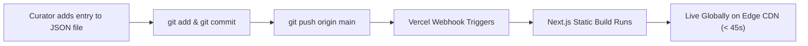

# Trillion Dollar Tweets — Project Dossier & Technical Overview

> **A comprehensive technical and architectural breakdown of Trillion Dollar Tweets, prepared for interviewers, engineering teams, and technical collaborators.**

---

## 1. Executive Summary

**Trillion Dollar Tweets** is a high-signal content curation platform designed to combat "algorithmic fatigue." Modern social media platforms trap users in dopamine loops driven by engagement-maximizing recommendation algorithms, burying deeply valuable insights under internet noise.

Trillion Dollar Tweets solves this through human-driven taste. Curated by the **Chief Taste Officer (CTO)**, the platform hand-picks the top 1% of transformative ideas across engineering, startups, design, career growth, podcasts, and music into a minimalist, distraction-free digital directory.

* **Live Demo / Repo:** [github.com/realshak7781/trilliondollartweets](https://github.com/realshak7781/trilliondollartweets)
* **Author / Curator:** Sharique Akhtar (realshak7781)
* **Core Stack:** Next.js 16 (App Router), React 19, TypeScript, Tailwind CSS v4, Vercel

---

## 2. Product Features & User Experience

| Feature | Description | Engineering Implementation |
| :--- | :--- | :--- |
| **High-Signal Tweet Directory** | Curated archive of valuable thoughts across tech, wealth, AI, and systems. | Next.js Server Components with client hydration for interactive filtering and deep linking. |
| **Bespoke Song Cards** | Curated songs featuring title, artist, personal takeaway ("Why I Like It"), and direct YouTube link. | Custom card UI without bloated third-party iframe embeds, optimizing bundle size and load times. |
| **Curated Podcast Cards** | Curated episodes featuring YouTube channel name, episode topic, editorial summary, and direct links. | Minimalist editorial cards with direct platform deep-linking. |
| **Dynamic Category Filtering** | Real-time filtering across categories (AI, Career, Creative, Software, UI, Wealth, Songs, Podcasts). | In-memory filtering with real-time category item counters and URL parameter sync. |
| **Deep-Linking Engine** | Direct navigation to specific entries via URL parameters (e.g. `/?tweet=2114604912520921136`). | `useSearchParams` hook and smooth auto-scrolling with target highlighting. |
| **Teach My Algorithm** | Community feedback loop allowing readers to submit high-signal tweets for review. | External form redirection (`https://forms.gle/...`). |
| **Newsletter Subscription** | Direct email capture for monthly high-signal roundups. | Next.js API Route Handler (`/api/newsletter`) integrating Web3Forms. |

---

## 3. Architecture & Technical Decisions

### A. The "Zero-Database" Static CMS Pattern
Instead of provisioning a heavy PostgreSQL database, Prisma ORM, or paid headless CMS (like Sanity/Contentful), all data lives in structured JSON files:
* `src/data/tweets.json`
* `src/data/songs.json`
* `src/data/podcasts.json`

**Why this architecture was chosen:**
1. **Zero Infrastructure Cost & Zero Maintenance:** No database connection limits, no connection pooling issues, no database migrations, and no monthly cloud bills.
2. **Instant Global Edge Latency:** Next.js compiles the catalog into static HTML/JSON at build time. Pages are served instantly from Vercel’s global Edge CDN with sub-100ms TTFB (Time to First Byte).
3. **Git as the Single Source of Truth:** Every content addition, modification, or deletion is version-controlled with full cryptographic Git history.
4. **Automated Continuous Deployment (CI/CD):** Pushing a JSON edit to the `main` branch automatically triggers Vercel build webhooks, updating the live site globally within 40 seconds.

### B. Frontend Architecture
* **Next.js 16 (App Router) + React 19:** Leverages modern React Server Components (RSC) to minimize client-side JavaScript bundle size while isolating interactive elements (filtering, dropdowns, newsletter forms) into focused `"use client"` components.
* **TypeScript (Strict Mode):** Fully typed interfaces for all entities (`Tweet`, `Song`, `Podcast`) to guarantee schema safety across data files and UI components.
* **Tailwind CSS v4:** Uses modern CSS token variables (`oklch` color spaces) to achieve an editorial, warm-dark luxury aesthetic with precise typography and fluid mobile responsiveness.

---

## 4. Key Engineering Challenges & Solutions

### Case Study 1: The Silent Data-Contract Failure (Case Sensitivity Bug)
* **The Problem:** When users clicked certain categories (such as "Wealth") in the category filter, the page displayed "0 tweets" and felt frozen/stalled, even though the tweet appeared perfectly on the "All categories" homepage.
* **Root Cause Investigation:** 
  The JSON file contained lowercase values (`category: "wealth"`), while the UI navigation array used TitleCase (`"Wealth"`). In `TweetGrid.tsx`, the filter used strict JavaScript equality:
  ```typescript
  // Broken logic
  initialTweets.filter((t) => t.category === effectiveCategory); // "wealth" === "Wealth" -> false!
  ```
  This caused the filter to silently evaluate to `[]` with zero runtime errors in console logs.
* **The Fix:**
  Implemented resilient, whitespace-trimmed, case-insensitive canonical matching across both the item filtering logic and the category count calculator:
  ```typescript
  // Resilient logic
  const target = effectiveCategory.trim().toLowerCase();
  return initialTweets.filter(
    (t) => (t.category || "").trim().toLowerCase() === target
  );
  ```
* **Verification:** Verified via Puppeteer automated browser testing; clicking "Wealth" immediately displayed `Total tweets: 1` and rendered the target card with zero latency.

---

### Case Study 2: Decoupling Template Lineage & Git Hygiene
* **The Problem:** The project was initially scaffolded from an open-source website cloner template. Upon pushing to GitHub, the repository inherited 80 past commits from 16 open-source contributors, along with outdated README demos and internal scraping scripts (`scripts/*.mjs`).
* **Root Cause:** In Git, `.gitignore` only ignores untracked files; files already tracked in git history remain tracked regardless of `.gitignore` updates.
* **The Fix:**
  1. Purged template-specific assets from Git tracking using `git rm -r --cached` without deleting local files.
  2. Hardened `.gitignore` to permanently exclude research scrapers, agent memory directories, and design artifacts.
  3. Created an **orphan branch** (`git checkout --orphan fresh-main`) and recommitted the codebase as a single, clean root commit.
  4. Force-pushed to GitHub, resetting the repository provenance to **1 commit** authored exclusively by `realshak7781`.

---

## 5. Project Directory Structure

```text
trilliondollartweets/
├── .gitignore              # Production-hardened exclusion rules
├── package.json            # Next.js 16, React 19, Tailwind v4
├── README.md               # User-facing repository overview
├── about.md                # Technical dossier for interviewers (this file)
├── public/                 # Static web assets, favicons, hero graphics
│   ├── hero.png
│   ├── siuuu_2.jpeg
│   └── site.webmanifest
└── src/
    ├── app/                # Next.js App Router routes
    │   ├── globals.css     # Global theme, typography, CSS tokens
    │   ├── layout.tsx      # Root HTML layout & font declarations
    │   ├── page.tsx        # Homepage (Hero + TweetGrid)
    │   ├── about/          # Editorial bio page
    │   ├── manifesto/      # Platform philosophy page
    │   ├── newsletter/     # Newsletter landing page
    │   └── api/
    │       └── newsletter/ # Route Handler for email capture (Web3Forms)
    ├── components/
    │   ├── ui/             # Reusable UI primitives
    │   └── sites/billiondollartweets/
    │       ├── Header.tsx  # Navigation bar
    │       ├── Hero.tsx    # Editorial hero section
    │       ├── TweetGrid.tsx # Filter dropdown + collection render engine
    │       ├── TweetCard.tsx # Individual tweet presentation card
    │       ├── SongCard.tsx  # Minimalist song card
    │       ├── PodcastCard.tsx # Minimalist podcast card
    │       ├── Newsletter.tsx# Inline newsletter subscription form
    │       └── Footer.tsx  # Site footer & external links
    ├── data/               # Flat-file database (Source of Truth)
    │   ├── tweets.json     # Curated tweets collection
    │   ├── songs.json      # Curated music recommendations
    │   └── podcasts.json   # Curated podcast episodes
    └── types/              # TypeScript contract definitions
        ├── tweet.ts        # Tweet interface schema
        ├── song.ts         # Song interface schema
        └── podcast.ts      # Podcast interface schema
```

---

## 6. How the Publishing Pipeline Works

When the curator finds a valuable new tweet, podcast, or song:



1. **Step 1:** Open `src/data/tweets.json` (locally in VS Code or directly on GitHub.com).
2. **Step 2:** Paste the new entry adhering to the TypeScript schema.
3. **Step 3:** Commit and push:
   ```bash
   git add src/data/
   git commit -m "feat: catalog new AI tweets"
   git push
   ```
4. **Step 4:** Vercel automatically compiles, validates TypeScript types, and deploys the update to production within 45 seconds with zero downtime.

---

## 7. Scalability & Future Roadmap

If the catalog expands from tens of items to tens of thousands of items:

1. **Static Search Engine:** Integrate a zero-runtime static search library like **Pagefind** or **Fuse.js** to provide sub-millisecond client-side full-text search across all tweet bodies and author handles.
2. **Database Migration (When Needed):** Seamlessly transition the JSON files into an embedded edge database like **Turso (LibSQL)** or **Cloudflare D1** while keeping the exact same TypeScript schema interfaces.
3. **Automated Ingestion Workers:** Implement a lightweight cron worker that listens to bookmarked tweets via the Twitter/X API and automatically opens a Pull Request with formatted JSON entries.
4. **RSS / Atom Feed:** Generate a static `feed.xml` route for readers who prefer consuming curated updates through feed readers.
